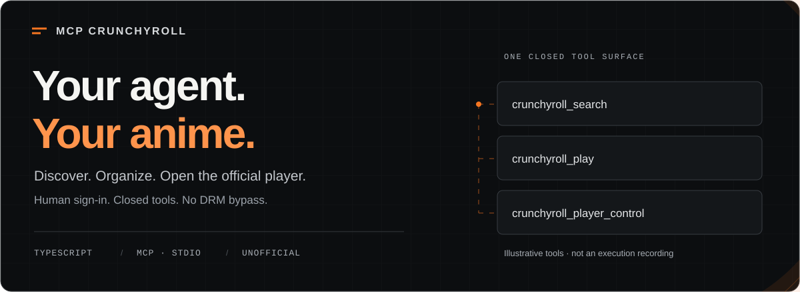
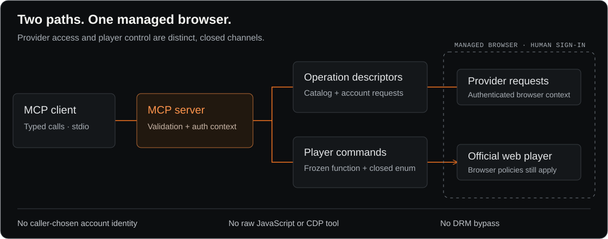

<picture>
  <source media="(max-width: 600px)" srcset="docs/assets/readme-hero-mobile.svg">
  
</picture>

# MCP Crunchyroll

**An unofficial anime connector for your AI agent.** Discover titles, organize your account and open Crunchyroll's official player through a closed [Model Context Protocol](https://modelcontextprotocol.io/) tool surface.

[Leia em português](docs/README-pt-BR.md)

[](https://github.com/Itthiago034/mcp-crunchyroll/actions/workflows/ci.yml)


[Quick start](#quick-start) · [Tools](#tool-surface) · [Architecture](#how-it-works) · [Security](#security-boundaries) · [Validation](#development-and-tests)

## What you can ask

After connecting the server and completing interactive sign-in, try asking your MCP client:

- “Search Crunchyroll for Frieren.”
- “Show the seasons and episodes for this series.”
- “What anime have I watched recently?”
- “Show my watchlist and recommend something similar.”

Available results depend on the authenticated account, region, client, and Crunchyroll's services.

## Release status

> [!IMPORTANT]
> **Development snapshot, not a production approval.** This local branch contains the existing 23-tool surface plus one candidate favorite setter. Registration and passing tests do not guarantee that Crunchyroll will accept a live request. See [the release decision](DECISAO-FINAL.md) for the audit gates.

| Surface | Count | Implementation status |
|---|---:|---|
| Authentication and status | 3 | Existing implementations |
| Catalog and discovery reads | 10 | Existing implementations |
| Account reads | 3 | Existing implementations |
| Watchlist and progress mutations | 3 | Existing implementations |
| Playback and player control | 2 | Existing implementations |
| Favorite setter | 1 | Candidate; unit-tested, live validation pending |
| Deferred tools | 2 | Deliberately fail closed |
| **Advertised tools in this local snapshot** | **24** | **Not a release count** |

### Start with what you want to do

| Your goal | Tools to start with | Boundary |
|---|---|---|
| Find something to watch | `crunchyroll_search`, `crunchyroll_browse` | Catalog results depend on the provider and region |
| Pick the right episode and audio version | `crunchyroll_get_seasons`, `crunchyroll_get_episodes` | Choose from returned IDs and locale metadata |
| Organize your list | `crunchyroll_get_watchlist`, `crunchyroll_add_to_watchlist` | Writes affect the authenticated account |
| Open and control playback | `crunchyroll_play`, `crunchyroll_player_control` | Official player; browser policies still apply |

## How it works

The server has **two distinct paths**: closed provider operations for catalog/account access, and closed player commands for the official web player. Interactive sign-in happens in the managed browser; authentication material is handled internally, not supplied by the agent as tool arguments.

<picture>
  <source media="(max-width: 600px)" srcset="docs/assets/readme-architecture-mobile.svg">
  
</picture>

<details>
<summary>Text version of the provider-request path</summary>

```text
MCP client
    |
    | stdio tool call
    v
MCP Crunchyroll
    |
    | closed operation descriptor + auth-derived account identity
    v
Managed browser / CDP
    |
    | provider request in the authenticated browser context
    v
Crunchyroll web services
```

</details>

Interactive credentials are entered only in the managed browser. Usernames, passwords, cookies, and bearer tokens are not tool arguments. Migrated provider operations use the browser-mediated transport; callers cannot choose an account ID or override the HTTP method, path, headers, query, or raw request body.

This project is not affiliated with or endorsed by Crunchyroll, LLC.

## Requirements

- Node.js 18 or newer
- npm
- A supported Chromium-family browser for interactive authentication, unless `CRUNCHYROLL_BROWSER_EXECUTABLE` points to one explicitly

<a id="install-and-build"></a>

## Quick start

1. Install Node.js 18 or newer and a supported Chromium-family browser.
2. Clone and build the repository with the commands below.
3. Point your MCP client at the built bundle (configuration further down).
4. Call `crunchyroll_login({})` and sign in yourself in the managed browser.
5. Check `crunchyroll_status({})`, then try one of the prompts above.

```bash
git clone https://github.com/Itthiago034/mcp-crunchyroll.git
cd mcp-crunchyroll
npm ci
npm run typecheck
npm run build
```

The production bundle is written to `dist/index.js`.

## Run

Run the built stdio server:

```bash
npm start
```

For development directly from TypeScript:

```bash
npm run dev
```

A generic MCP client configuration for the built bundle looks like this:

```json
{
  "mcpServers": {
    "crunchyroll": {
      "command": "node",
      "args": ["/absolute/path/to/mcp-crunchyroll/dist/index.js"]
    }
  }
}
```

The repository also includes `manifest.yaml` for compatible Hermes Agent installations.

### Hermes Agent

After building, register the bundle with Hermes:

```bash
hermes mcp add crunchyroll --command node --args /absolute/path/to/mcp-crunchyroll/dist/index.js
hermes mcp test crunchyroll
```

<details>
<summary>Linux desktop and browser-session details</summary>

Hermes exposes the tools as `mcp__crunchyroll__crunchyroll_*` and starts stdio servers with a filtered environment that keeps `HOME`, `PATH` and `XDG_*` but drops `DISPLAY`, `WAYLAND_DISPLAY` and `DBUS_SESSION_BUS_ADDRESS`. On Linux, when no display variable reaches the server, it recovers the user's own desktop session from sockets owned by the current user (`$XDG_RUNTIME_DIR/wayland-N`, `$XDG_RUNTIME_DIR/bus`, `/tmp/.X11-unix/XN`), so `crunchyroll_login` can open its window without extra `env` entries. It also restores the desktop identity (`KDE_SESSION_VERSION`, `DESKTOP_SESSION`, `XDG_CURRENT_DESKTOP`, ...) from `systemctl --user show-environment`: without it Chromium picks a different password store than the manual sign-in did (for example `basic` instead of KWallet 6), cannot decrypt the profile's cookies and is challenged again. Variables the client does pass are never replaced.

</details>

## Authentication

Call:

```text
crunchyroll_login({})
```

The login tool takes no arguments. It opens Crunchyroll in a dedicated managed browser, where the user completes sign-in and any human verification directly. The MCP server grants readiness only after observing and validating authentication material from that browser flow.

Useful local tools:

| Tool | Purpose | Status |
|---|---|---|
| `crunchyroll_login` | Start interactive browser sign-in | Operational |
| `crunchyroll_logout` | Invalidate the local authenticated context and clear managed artifacts | Operational |
| `crunchyroll_status` | Report auth and browser readiness | Operational |

The managed browser profile is stored under `~/.strider/crunchyroll/browser-profile`. Do not point the server at a personal browser profile.

The live validator (`npm run validate:live -- --login`) first opens the selected
browser directly for manual sign-in in the same dedicated profile, without CDP.
Complete verification and sign-in in Crunchyroll's own UI, decline browser-data
import, and close that window normally. The validator then opens the managed
browser and confirms MCP authentication before issuing its 12 reads. Close any
earlier windows of that dedicated profile before starting. You can also run
`npm run onboard:browser` separately to check the manual stage. Only an observed
and validated authentication response grants MCP readiness; this flow does not
guarantee that the provider will accept the session. See the
[recorded onboarding procedure](CRUNCHYROLL-BT4-N5-ONBOARDING-ERRATA.md).

### Session expiry

The bearer observed from the browser carries no refresh token and expires within minutes. `crunchyroll_status` reports an expired bearer as not authenticated, and `crunchyroll_login` then re-establishes it by reloading the signed-in managed page, which makes Crunchyroll mint a fresh bearer under observation. A content call that finds the session expired does this once on its own (waiting up to 45 s) and retries; the failure happens before anything is dispatched, so nothing is sent twice. A fresh server process still starts unauthenticated: call `crunchyroll_login` once, which takes seconds while the browser profile is signed in. Season and episode lists are compacted to the fields needed to choose and play (ids, numbers, titles, locales, availability and `versions` as `{audio_locale, guid, original}`); `crunchyroll_get_series` and `crunchyroll_get_episode` return the full record without image sets. `crunchyroll_get_episodes` accepts an optional `episode_number` to return a single episode, `crunchyroll_get_history` keeps resume data instead of the full panel, and `crunchyroll_get_watchlist` honours `n` and adds each item's `title` and `type` with one extra batched read. Login waits at most 240 s, below the 300 s tool timeout of clients such as Hermes.

## Tool surface

### Catalog and discovery

| Tool | Purpose |
|---|---|
| `crunchyroll_search` | Search titles |
| `crunchyroll_browse` | Browse by supported sort, category, season, and availability filters |
| `crunchyroll_get_categories` | List browse categories |
| `crunchyroll_get_simulcast_seasons` | List simulcast season tags |
| `crunchyroll_get_series` | Read series details |
| `crunchyroll_get_seasons` | Read seasons for a series |
| `crunchyroll_get_episodes` | Read episodes for a season |
| `crunchyroll_get_episode` | Read one episode |
| `crunchyroll_get_recommendations` | Read personalized recommendations |
| `crunchyroll_get_similar` | Read titles similar to a series |

### Account reads

| Tool | Purpose |
|---|---|
| `crunchyroll_get_watchlist` | Read the authenticated account's watchlist |
| `crunchyroll_get_history` | Read watch history |
| `crunchyroll_get_playheads` | Read playheads for selected content IDs |

### Account mutations

| Tool | Purpose | Provider success |
|---|---|---|
| `crunchyroll_add_to_watchlist` | Add a content ID to the authenticated account's watchlist | `204 No Content` |
| `crunchyroll_remove_from_watchlist` | Remove a content ID from the authenticated account's watchlist | `204 No Content` |
| `crunchyroll_update_playhead` | Submit a playhead for a content ID | `204 No Content` |
| `crunchyroll_set_favorite` | Set an explicit favorite boolean; never toggle | Candidate contract: `204 No Content`; live validation pending |

**Favorite setter caveat:** this local addition is unit-tested but has not completed live provider verification. `favorite: false` on an absent item is a no-op; `favorite: true` may add the item before setting its favorite flag. Do not treat it as a verified release feature yet.

Mutation identity is derived from the authenticated browser context. The caller supplies only the functional inputs in each closed tool schema and cannot select `accountId`.

A provider response such as bad request, conflict, or operation-specific not found is reported deterministically. If a write may have been dispatched but its result cannot be known—for example, because the browser disconnects after possible dispatch—the operation returns `MUTATION_OUTCOME_UNKNOWN`. The server does not blindly retry mutations. Callers can reconcile playhead state with `crunchyroll_get_playheads` when appropriate.

### Playback

| Tool | Purpose |
|---|---|
| `crunchyroll_play` | Open an episode's watch page (`https://www.crunchyroll.com/watch/<episode_id>`) in a focused tab of the signed-in managed browser, reusing the playback tab if one is open. Optional `autoplay` / `fullscreen` booleans run the native player controls once the player loads |
| `crunchyroll_player_control` | `{"action": "play" \| "pause" \| "fullscreen" \| "exit_fullscreen" \| "status"}` on the playback tab; reports `executed`, `verified`, `outcome` and the observed `state` |

`episode_id` must be a plain uppercase Crunchyroll id from `crunchyroll_get_episodes`; nothing else reaches the URL. Playback uses the browser's own signed-in session and makes no provider API request from the server.

Player control runs one frozen page function with a closed command set, only in the playback tab's page and player-frame contexts on `www.crunchyroll.com` / `static.crunchyroll.com`. It exposes no script, CDP or port to the caller, never reads cookies or tokens, and reports success only when a later observation confirms the requested state. Autoplay and fullscreen remain subject to the browser's own policies; a refusal is reported as `REFUSED_BY_BROWSER`, never bypassed. See [ARQUITETURA.md](ARQUITETURA.md) and [SEGURANCA.md](SEGURANCA.md).

### Deferred tools

These names remain visible for compatibility, but v0.1.0 intentionally refuses them with `OPERATION_NOT_MIGRATED`:

| Tool | v0.1.0 status |
|---|---|
| `crunchyroll_continue_watching` | Deferred / fail-closed |
| `crunchyroll_get_subscription` | Deferred / fail-closed |

These two tools are excluded from the implemented paths described above; their presence in the advertised catalog is not a claim of availability.

## Security boundaries

- Interactive secrets are entered in the managed browser, not passed as MCP tool arguments.
- Provider access for migrated operations is mediated by the managed browser/CDP boundary.
- Authorization and content type are controlled internally.
- Account mutation identity is auth-derived.
- Unknown or forbidden caller arguments are rejected instead of silently discarded.
- Mutation outcomes that become uncertain after possible dispatch fail closed as `MUTATION_OUTCOME_UNKNOWN`.
- No automatic retry is performed for uncertain mutations.
- Browser transport uses `credentials: "omit"` and manual redirect handling.
- CI provisions pinned Chrome for Testing with its sandbox enabled; `--no-sandbox` is not used.

These controls describe the implemented boundaries; they are not a claim of absolute containment against every host or browser threat.

## Development and tests

```bash
npm ci
npm run typecheck
npm run build
npm test
```

The test command runs the unit suites and MCP stdio harness. GitHub Actions repeats install, typecheck, build, and tests independently on Node.js 18, 20, and 22, including the sandboxed browser lifecycle checks.

The [architecture, security, and network review](docs/architecture-review.md) records transport resource limits, regression evidence, dependency audit results, and measurements still needed against the real provider.

Run `npm run test:browser` for concurrent HTTP validation in real Chromium. The
[browser validation report](docs/browser-validation.md) includes measured load
results and the optional anonymous/live MCP commands; `npm run validate:live -- --login`
requires interactive sign-in in a visible managed browser.

## Known limitations

- `crunchyroll_continue_watching` is deferred and fails closed.
- `crunchyroll_get_subscription` is deferred and fails closed.
- Crunchyroll's internal web interfaces are not a stable public API and may change.
- The project opens and controls the official web player only; it does not download media or bypass DRM, autoplay or fullscreen policies.
- Fullscreen and autoplay can still be refused by the browser or by the player frame (see `REFUSED_BY_BROWSER` in the skill).
- Authentication can require user interaction in the managed browser.

## Read further

| Document | What it covers |
|---|---|
| [Architecture](ARQUITETURA.md) | Channels, boundaries and component responsibilities |
| [Security](SEGURANCA.md) | Threat model, guarantees and residual risks |
| [Tests](TESTES.md) | Test environments and recorded evidence |
| [Benchmarks](BENCHMARK.md) | Measurements and their real/synthetic/modeled labels |
| [Release decision](DECISAO-FINAL.md) | Audit and authorized live-validation gates |

<details>
<summary>Original project artwork</summary>


</details>

## Credits and license

Based on the open-source `@striderlabs/mcp-crunchyroll` project by StrikerLabs. Distributed under the MIT License.

## Disclaimer

**Unofficial community project. Not affiliated with or endorsed by Crunchyroll, LLC.** “Crunchyroll” and related names and marks belong to their respective owners.
