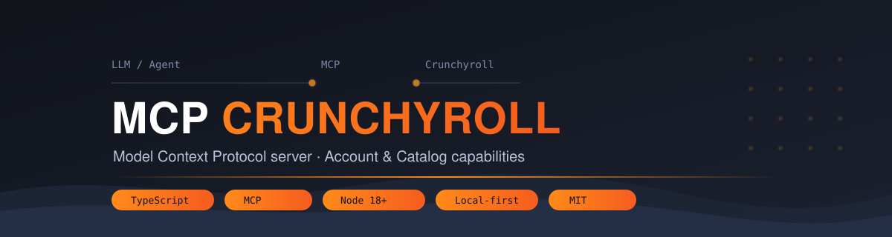
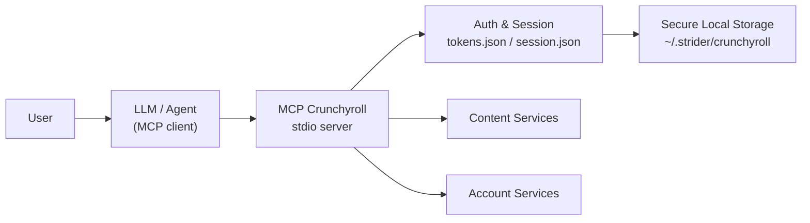

# MCP Crunchyroll

> A Model Context Protocol (MCP) server that lets AI agents interact with your Crunchyroll account and content catalog — search, browse, watchlist, history, playback progress, and recommendations.

[](https://github.com/Itthiago034/mcp-crunchyroll/actions/workflows/ci.yml)


**TypeScript** · **MCP stdio** · **Local-first credential storage** · MIT

---

## Project Status

| Area | Status |
|------|--------|
| MCP stdio server & tool discovery (21 tools) | ✅ Validated |
| Secure local credential storage | ✅ Validated |
| Persisted auth schema validation | ✅ Validated |
| Operation-scoped secret redaction | ✅ Validated |
| Structured refresh failure classification | ✅ Validated |
| CI (Node 18 / 20 / 22) | ✅ Validated |
| Live Crunchyroll authentication | ◐ Under compatibility investigation |
| Structured logout | ◐ In progress |
| Hermes / browser playback integration | ○ Planned (experimental) |

> Live Crunchyroll authentication is currently under compatibility investigation due to changes in the web SSO flow. Account operations are validated end-to-end within the local MCP test harness, not against a live Crunchyroll session.

See [Roadmap](#roadmap) for details.

---

## Why This Project

MCP lets AI agents use tools through a standardized protocol. **MCP Crunchyroll** exposes Crunchyroll's catalog and account capabilities as MCP tools, so an agent can search for anime, manage a watchlist, track where you left off, and suggest what to watch next — with credential artifacts stored securely on your machine. They are never sent to unrelated third parties; authenticated requests communicate only with Crunchyroll services as required.

---

## Capabilities

| Category | What you can do |
|----------|-----------------|
| **Discovery** | Search titles, browse by genre/popularity/new releases, list categories and simulcast seasons, get recommendations and similar titles |
| **Series & Episodes** | Series details, seasons, episode lists, individual episode info |
| **Account** | Watchlist (view / add / remove), watch history, continue-watching list, subscription info |
| **Playback State** | Read playhead positions, update watch progress |
| **Authentication** | Local login, logout, and status checks with auto-refresh |

Full per-tool reference: [docs/tools.md](docs/tools.md)

---

## Architecture



The **security boundary** sits between the agent and every operation:

```text
LLM Agent
   ↓  tool calls
MCP Boundary  ← secret redaction (operation-scoped registry)
   ↓
Typed Operations (refresh state machine; structured logout — candidate)
   ↓
Auth / Catalog / Account
   ↓
Secure Local Storage (0700 dirs, symlink & owner validation, schema checks)
```

Detailed documentation: [docs/architecture.md](docs/architecture.md) · [docs/security.md](docs/security.md)

---

## Quick Start

### Installation

```bash
git clone https://github.com/Itthiago034/mcp-crunchyroll.git
cd mcp-crunchyroll
```

### Build

```bash
npm ci
npm run typecheck
npm run build
```

### Run

```bash
node dist/index.js          # compiled bundle
# or, for development:
npm run dev                 # tsx src/index.ts
```

### Connect to an MCP client

Generic stdio configuration (Claude Desktop, any stdio-capable client):

```json
{
  "mcpServers": {
    "crunchyroll": {
      "command": "node",
      "args": ["/absolute/path/to/mcp-crunchyroll/dist/index.js"]
    }
  }
}
```

Or via the packaged catalog entry for Hermes Agent (`manifest.yaml`); see [docs/development.md](docs/development.md).

Live login compatibility is currently under revalidation. Once a valid local session is established, tokens are saved under `~/.strider/crunchyroll/` and refreshed automatically.

---

## MCP Tools

21 tools across five categories:

| Category | Tools |
|----------|-------|
| Authentication | `crunchyroll_login` · `crunchyroll_logout` · `crunchyroll_status` |
| Discovery | `crunchyroll_search` · `crunchyroll_browse` · `crunchyroll_get_categories` · `crunchyroll_get_simulcast_seasons` · `crunchyroll_get_recommendations` · `crunchyroll_get_similar` |
| Series & Episodes | `crunchyroll_get_series` · `crunchyroll_get_seasons` · `crunchyroll_get_episodes` · `crunchyroll_get_episode` |
| Account | `crunchyroll_get_watchlist` · `crunchyroll_add_to_watchlist` · `crunchyroll_remove_from_watchlist` · `crunchyroll_get_history` · `crunchyroll_continue_watching` · `crunchyroll_get_subscription` |
| Playback State | `crunchyroll_get_playheads` · `crunchyroll_update_playhead` |

Detailed descriptions, inputs, and statuses: [docs/tools.md](docs/tools.md)

---

## Security Model

- **Secure local storage** — credentials stored in `~/.strider/crunchyroll/` with restrictive permissions; directories validated against symlinks, insecure modes, and owner drift.
- **Persisted schema validation** — stored tokens are structurally validated against a frozen schema before use.
- **Secret redaction** — known-sensitive tool arguments (passwords, tokens) are redacted at the MCP boundary through an operation-scoped registry.
- **Structured refresh classification** — refresh failures are classified (transient vs. reauthentication required); transient failures never discard saved credentials.
- **Structured logout** (candidate, in progress) — an upcoming change makes local logout report per-artifact results (`CLEARED`, `ALREADY_ABSENT`, `PARTIAL`, `FAILED`) instead of silently swallowing errors; it is not yet present in `main`.

Full model: [docs/security.md](docs/security.md)

---

## Examples

### Supported MCP interaction

Ask your agent, in plain language:

> "Search for Frieren"
> "Show the episodes from season 1"
> "What's in my watchlist?"
> "What can I continue watching?"
> "Show recommendations"
> "Where did I leave off?"

The agent translates these into tool calls — no browser or playback automation is involved.

### Where this is going (planned / experimental — not implemented)

```text
User
  ↓
Hermes
  ↓
MCP Crunchyroll
  ↓
Resolve title / season / episode
  ↓
Browser capability ── planned / experimental ──▶ Official Crunchyroll player
```

Direct episode navigation, playback, pause/resume, next episode, seek, and fullscreen inside the official player are **technically demonstrated as feasible** and remain a planned integration area. They are **not part of the current MCP runtime** and are not implemented in this project.

---

## Roadmap

| Item | Status |
|------|--------|
| MCP stdio foundation | ✅ |
| CI / deterministic harness (Node 18 / 20 / 22) | ✅ |
| Secure local storage | ✅ |
| Persisted schema validation | ✅ |
| Secret redaction | ✅ |
| Refresh state machine | ✅ |
| Structured logout | ◐ in progress |
| Live auth compatibility | ◐ in progress |
| Out-of-band CLI authentication | ○ planned |
| Hermes integration | ○ planned |
| Browser playback orchestration | ○ planned |

Legend: ✅ completed (validated in this repository) · ◐ in progress · ○ planned. No dates are guaranteed.

---

## Current Limitations

- This is an **unofficial** integration. Crunchyroll's internal interfaces may change without notice, and there is no official Crunchyroll developer API contract.
- **Live authentication is currently being revalidated** against the current web SSO flow.
- The browser/player experience shown in *Where this is going* is **not part of the current MCP runtime**.
- The package identity (`@striderlabs/mcp-crunchyroll`) is under review before any distribution.

---

## Development

```bash
npm run typecheck        # static type check
npm run build            # esbuild → dist/index.js
npm test                 # unit + MCP stdio harness tests
npm run dev              # run from TypeScript source via tsx
```

Details (Hermes catalog entry, manual config, testing conventions): [docs/development.md](docs/development.md)

---

## Credits & License

Based on the open-source `@striderlabs/mcp-crunchyroll` package by StrikerLabs ([github.com/markswendsen-code/mcp-crunchyroll](https://github.com/markswendsen-code/mcp-crunchyroll)), distributed under the MIT License. This repository is MIT-licensed.

## Disclaimer

> **Unofficial community project. Not affiliated with or endorsed by Crunchyroll, LLC.**
>
> "Crunchyroll" and related names and marks are the property of their respective owners. This project does not distribute content, does not bypass DRM, and does not implement media downloading. It interacts with the same web interfaces as the official website through a local MCP server.
