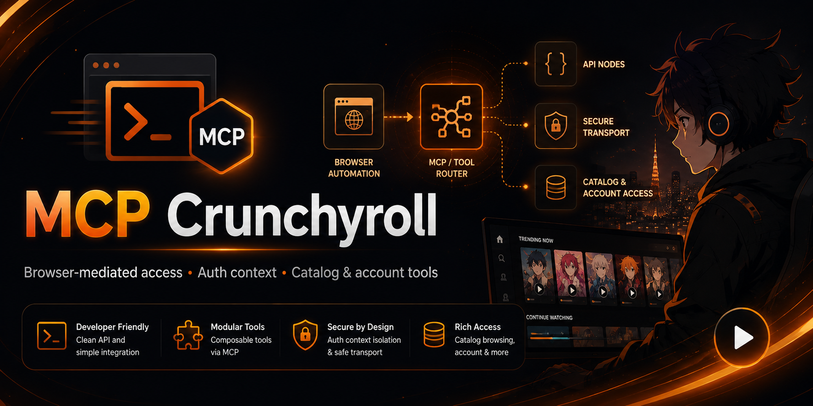
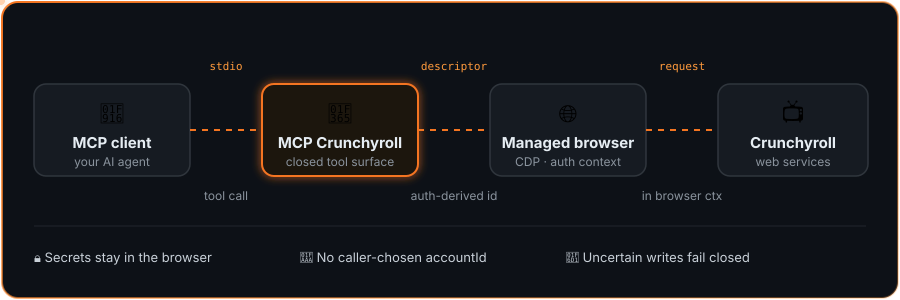

<p align="center">
  
</p>

<h1 align="center">🍥 MCP Crunchyroll</h1>

<p align="center">
  <strong>Let your AI agent find anime, manage your watchlist and press play,<br/>without ever handing it your password.</strong>
</p>

<p align="center">
  <a href="https://github.com/Itthiago034/mcp-crunchyroll/actions/workflows/ci.yml"></a>
  
  
  
  
  
</p>

<p align="center">
  <a href="#-quick-start">Quick start</a> •
  <a href="#-stays-signed-in">Stays signed in</a> •
  <a href="#tool-surface">Tools</a> •
  <a href="#security-boundaries">Security</a> •
  <a href="docs/README-pt-BR.md">Leia em português</a>
</p>

---

An unofficial [Model Context Protocol](https://modelcontextprotocol.io/) server for Crunchyroll, written in TypeScript. Your MCP client (Claude, Hermes, or any other) gets a closed set of tools for the catalog, your account and the player. You sign in yourself in a dedicated browser window, and the server keeps that session warm.

<p align="center">
  
</p>

## ✨ Highlights

<table>
  <tr>
    <td width="25%" valign="top">

### 🔎 Discover
Search, browse by genre or simulcast season, drill into series, seasons and episodes (with every audio version), and get **recommendations**.

</td>
    <td width="25%" valign="top">

### 📚 Your account
Read your **watchlist**, **history** and **progress**. Add or remove titles, set **favorites** and update progress from chat.

</td>
    <td width="25%" valign="top">

### ▶️ Watch
Open an episode, **play, pause and go fullscreen**. The server confirms the video is really playing, not just that the page opened.

</td>
    <td width="25%" valign="top">

### 🔒 Safe by design
Sign-in happens only in the **managed browser**. No passwords, cookies or tokens in tool arguments, and uncertain writes **fail closed**.

</td>
  </tr>
</table>

## 💬 What you can ask

- “Search Crunchyroll for Frieren and play episode 1 dubbed in Portuguese, fullscreen.”
- “What did I watch recently? Continue where I stopped.”
- “Show my watchlist and recommend something similar.”
- “Favorite this series.”

Results depend on your account, region and Crunchyroll's own services.

## 🚀 Quick start

1. Install Node.js 18 or newer and a Chromium-family browser (Chrome, Chromium, Brave or Edge).
2. Build the server:

   ```bash
   git clone https://github.com/Itthiago034/mcp-crunchyroll.git
   cd mcp-crunchyroll
   npm ci && npm run build
   ```

3. Add it to your MCP client:

   ```json
   {
     "mcpServers": {
       "crunchyroll": {
         "command": "node",
         "args": ["/absolute/path/to/mcp-crunchyroll/dist/index.js"]
       }
     }
   }
   ```

4. Ask your agent to log in. It calls `crunchyroll_login`, a browser window opens on Crunchyroll's own page, and you sign in there **once**.
5. That's it. Ask for anything in the list above.

## 🔥 Stays signed in

<p align="center">
  
</p>

Crunchyroll's web token lasts only a few minutes and comes with no refresh token. Instead of making a tool call wait for a renewal (or ask you to log in again), a **session keeper** renews it in the background the moment it expires, in a hidden tab, never in the tab you are watching.

- **You sign in once.** The dedicated browser profile keeps Crunchyroll's own long-lived sign-in, so a restarted server re-establishes the session by itself.
- **Calls stay fast.** While tools are in use, the token is always fresh. After an hour without use the keeper rests, and the next call wakes it.
- **The agent always knows what to do.** `crunchyroll_status` returns one closed `next_action`: `NONE`, `CALL_CRUNCHYROLL_LOGIN`, `WAIT_FOR_LOGOUT` or `RETRY_LATER`, plus `session.keep_warm`, `expires_in_s` and `next_renewal_in_s`.
- **It never signs in for you.** If Crunchyroll ends the session (logout, password change, revocation), the keeper stops and asks for `crunchyroll_login`. It does not retry in a loop.

| Variable | Default | Effect |
|---|---|---|
| `CRUNCHYROLL_KEEP_WARM_MINUTES` | `60` | How long the keeper stays active after the last tool call. `0` turns it off |
| `CRUNCHYROLL_WARM_START` | off | `1` re-establishes a saved session as soon as the server starts, so even the first call is fast. It opens the browser at startup |

## Release status

This branch exposes 24 public tools. Twenty-two are operational: three authentication/status tools, seventeen production API operations and two playback tools. Two published tools remain deliberately deferred and fail closed.

| Surface | Count | Status |
|---|---:|---|
| Public MCP tools | 24 | Published |
| Authentication and status tools | 3 | Operational |
| Production API operations | 17 | Operational |
| Playback and player control | 2 | Operational |
| Deferred tools | 2 | `OPERATION_NOT_MIGRATED` |

CI validates the project on Node.js 18, 20, and 22 with sandboxed Chrome for Testing.

## How it works

<p align="center">
  
</p>

Interactive credentials are entered only in the managed browser. Usernames, passwords, cookies, and bearer tokens are not tool arguments. Provider operations run inside the authenticated browser page; callers cannot choose an account ID or override the HTTP method, path, headers, query, or raw request body.

This project is not affiliated with or endorsed by Crunchyroll, LLC.

## Requirements

- Node.js 18 or newer
- npm
- A supported Chromium-family browser for interactive authentication, unless `CRUNCHYROLL_BROWSER_EXECUTABLE` points to one explicitly

## Install and build

```bash
git clone https://github.com/Itthiago034/mcp-crunchyroll.git
cd mcp-crunchyroll
npm ci
npm run typecheck
npm run build
```

The production bundle is written to `dist/index.js`.

## Run

Run the built stdio server:

```bash
npm start
```

For development directly from TypeScript:

```bash
npm run dev
```

A generic MCP client configuration for the built bundle looks like this:

```json
{
  "mcpServers": {
    "crunchyroll": {
      "command": "node",
      "args": ["/absolute/path/to/mcp-crunchyroll/dist/index.js"]
    }
  }
}
```

The repository also includes `manifest.yaml` for compatible Hermes Agent installations.

### Hermes Agent

After building, register the bundle with Hermes:

```bash
hermes mcp add crunchyroll --command node --args /absolute/path/to/mcp-crunchyroll/dist/index.js
hermes mcp test crunchyroll
```

Hermes exposes the tools as `mcp__crunchyroll__crunchyroll_*` and starts stdio servers with a filtered environment that keeps `HOME`, `PATH` and `XDG_*` but drops `DISPLAY`, `WAYLAND_DISPLAY` and `DBUS_SESSION_BUS_ADDRESS`. On Linux, when no display variable reaches the server, it recovers the user's own desktop session from sockets owned by the current user (`$XDG_RUNTIME_DIR/wayland-N`, `$XDG_RUNTIME_DIR/bus`, `/tmp/.X11-unix/XN`), so `crunchyroll_login` can open its window without extra `env` entries. It also restores the desktop identity (`KDE_SESSION_VERSION`, `DESKTOP_SESSION`, `XDG_CURRENT_DESKTOP`, ...) from `systemctl --user show-environment`: without it Chromium picks a different password store than the manual sign-in did (for example `basic` instead of KWallet 6), cannot decrypt the profile's cookies and is challenged again. Variables the client does pass are never replaced.

## Authentication

Call:

```text
crunchyroll_login({})
```

The login tool takes no arguments. It opens Crunchyroll in a dedicated managed browser, where the user completes sign-in and any human verification directly. The MCP server grants readiness only after observing and validating authentication material from that browser flow.

Making sign-in painless:

- **It is a one-time step.** The dedicated profile remembers the sign-in, so you are asked again only if Crunchyroll ends the session.
- **Use whatever Crunchyroll's own page offers.** If your account uses Google or Apple sign-in, those buttons work in the managed window like in any browser.
- **Let the agent decide when.** Agents should call `crunchyroll_status` and follow `next_action` instead of calling `crunchyroll_login` on every error; a content call already renews a saved session by itself.

Useful local tools:

| Tool | Purpose | Status |
|---|---|---|
| `crunchyroll_login` | Start interactive browser sign-in | Operational |
| `crunchyroll_logout` | Invalidate the local authenticated context and clear managed artifacts | Operational |
| `crunchyroll_status` | Report auth and browser readiness | Operational |

The managed browser profile is stored under `~/.strider/crunchyroll/browser-profile`. Do not point the server at a personal browser profile.

The live validator (`npm run validate:live -- --login`) first opens the selected
browser directly for manual sign-in in the same dedicated profile, without CDP.
Complete verification and sign-in in Crunchyroll's own UI, decline browser-data
import, and close that window normally. The validator then opens the managed
browser and confirms MCP authentication before issuing its 12 reads. Close any
earlier windows of that dedicated profile before starting. You can also run
`npm run onboard:browser` separately to check the manual stage. Only an observed
and validated authentication response grants MCP readiness; this flow does not
guarantee that the provider will accept the session. See the
[recorded onboarding procedure](CRUNCHYROLL-BT4-N5-ONBOARDING-ERRATA.md).

### Session expiry

The bearer observed from the browser carries no refresh token and expires within minutes. The session keeper (see [Stays signed in](#-stays-signed-in)) renews it right after it expires by reloading the hidden, signed-in managed tab, which makes Crunchyroll mint a fresh bearer under observation. A content call that still finds the session expired joins the same renewal instead of starting another one (waiting up to 40 s); the failure happens before anything is dispatched, so nothing is sent twice. A new server process re-establishes a session the user already authorized on its first content call, or at startup with `CRUNCHYROLL_WARM_START=1`. Login waits at most 240 s, below the 300 s tool timeout of clients such as Hermes.

Season and episode lists are compacted to the fields needed to choose and play (ids, numbers, titles, locales, availability and `versions` as `{audio_locale, guid, original}`); `crunchyroll_get_series` and `crunchyroll_get_episode` return the full record without image sets. `crunchyroll_get_episodes` accepts an optional `episode_number` to return a single episode, `crunchyroll_get_history` keeps resume data instead of the full panel, and `crunchyroll_get_watchlist` honours `n` and adds each item's `title` and `type` with one extra batched read.

## Tool surface

### Catalog and discovery

| Tool | Purpose |
|---|---|
| `crunchyroll_search` | Search titles |
| `crunchyroll_browse` | Browse by supported sort, category, season, and availability filters |
| `crunchyroll_get_categories` | List browse categories |
| `crunchyroll_get_simulcast_seasons` | List simulcast season tags |
| `crunchyroll_get_series` | Read series details |
| `crunchyroll_get_seasons` | Read seasons for a series |
| `crunchyroll_get_episodes` | Read episodes for a season |
| `crunchyroll_get_episode` | Read one episode |
| `crunchyroll_get_recommendations` | Read personalized recommendations |
| `crunchyroll_get_similar` | Read titles similar to a series |

### Account reads

| Tool | Purpose |
|---|---|
| `crunchyroll_get_watchlist` | Read the authenticated account's watchlist |
| `crunchyroll_get_history` | Read watch history |
| `crunchyroll_get_playheads` | Read playheads for selected content IDs |

### Account mutations

| Tool | Purpose | Provider success |
|---|---|---|
| `crunchyroll_add_to_watchlist` | Add a content ID to the authenticated account's watchlist | `204 No Content` |
| `crunchyroll_remove_from_watchlist` | Remove a content ID from the authenticated account's watchlist | `204 No Content` |
| `crunchyroll_update_playhead` | Submit a playhead for a content ID | `204 No Content` |
| `crunchyroll_set_favorite` | `{"content_id", "favorite": true \| false}`: set the favorite (heart) state. Idempotent, never a toggle; favoriting an item not on the watchlist adds it first (`added_to_watchlist: true`), unfavoriting one that is absent is a `NOOP` | `200` / `204` (status only; the body is not read). Not yet confirmed against the live API |

Mutation identity is derived from the authenticated browser context. The caller supplies only the functional inputs in each closed tool schema and cannot select `accountId`.

A provider response such as bad request, conflict, or operation-specific not found is reported deterministically. If a write may have been dispatched but its result cannot be known—for example, because the browser disconnects after possible dispatch—the operation returns `MUTATION_OUTCOME_UNKNOWN`. The server does not blindly retry mutations. Callers can reconcile playhead state with `crunchyroll_get_playheads` when appropriate.

### Playback

| Tool | Purpose |
|---|---|
| `crunchyroll_play` | Open an episode's watch page (`https://www.crunchyroll.com/watch/<episode_id>`) in a focused tab of the signed-in managed browser, reusing the playback tab if one is open. Optional `autoplay` / `fullscreen` booleans run the native player controls once the player loads. With `autoplay`, `playing_verified` is true only when `current_time` advanced |
| `crunchyroll_player_control` | `{"action": "play" \| "pause" \| "fullscreen" \| "exit_fullscreen" \| "status"}` on the playback tab; reports `executed`, `verified`, `outcome` and the observed `state` (including `player_error`). A confirmed `play` also reports `progress`: `ADVANCING` when `current_time` was seen moving, `STALLED` otherwise |

`episode_id` must be a plain uppercase Crunchyroll id from `crunchyroll_get_episodes`; nothing else reaches the URL. Playback uses the browser's own signed-in session and makes no provider API request from the server.

Player control runs one frozen page function with a closed command set, only in the playback tab's page and player-frame contexts on `www.crunchyroll.com` / `static.crunchyroll.com`. It exposes no script, CDP or port to the caller, never reads cookies or tokens, and reports success only when a later observation confirms the requested state. Autoplay and fullscreen remain subject to the browser's own policies; a refusal is reported as `REFUSED_BY_BROWSER`, never bypassed. See [ARQUITETURA.md](ARQUITETURA.md) and [SEGURANCA.md](SEGURANCA.md).

### Results and errors

Every tool returns compact JSON text and the same object as `structuredContent`. Errors carry `code`, `retryable` and a fixed `hint`; a `403` also carries the closed shape of the refusal (`html-response` for an edge or bot challenge, `json-response` for a provider permission answer) and never any of its content.

### Deferred tools

These names remain visible for compatibility, but v0.1.0 intentionally refuses them with `OPERATION_NOT_MIGRATED`:

| Tool | v0.1.0 status |
|---|---|
| `crunchyroll_continue_watching` | Deferred / fail-closed |
| `crunchyroll_get_subscription` | Deferred / fail-closed |

They are not counted among the 19 operational tools.

## Security boundaries

- Interactive secrets are entered in the managed browser, not passed as MCP tool arguments.
- Provider access for migrated operations is mediated by the managed browser/CDP boundary.
- Authorization and content type are controlled internally.
- Account mutation identity is auth-derived.
- Unknown or forbidden caller arguments are rejected instead of silently discarded.
- Mutation outcomes that become uncertain after possible dispatch fail closed as `MUTATION_OUTCOME_UNKNOWN`.
- No automatic retry is performed for uncertain mutations.
- Browser transport uses `credentials: "omit"` and manual redirect handling.
- CI provisions pinned Chrome for Testing with its sandbox enabled; `--no-sandbox` is not used.

These controls describe the implemented boundaries; they are not a claim of absolute containment against every host or browser threat.

## Development and tests

```bash
npm ci
npm run typecheck
npm run build
npm test
```

The test command runs the unit suites and MCP stdio harness. GitHub Actions repeats install, typecheck, build, and tests independently on Node.js 18, 20, and 22, including the sandboxed browser lifecycle checks.

The [architecture, security, and network review](docs/architecture-review.md) records transport resource limits, regression evidence, dependency audit results, and measurements still needed against the real provider.

Run `npm run test:browser` for concurrent HTTP validation in real Chromium. The
[browser validation report](docs/browser-validation.md) includes measured load
results and the optional anonymous/live MCP commands; `npm run validate:live -- --login`
requires interactive sign-in in a visible managed browser.

## Known limitations

- `crunchyroll_continue_watching` is deferred and fails closed.
- `crunchyroll_get_subscription` is deferred and fails closed.
- Crunchyroll's internal web interfaces are not a stable public API and may change.
- The project opens and controls the official web player only; it does not download media or bypass DRM, autoplay or fullscreen policies.
- Fullscreen and autoplay can still be refused by the browser or by the player frame (see `REFUSED_BY_BROWSER` in the skill).
- The first sign-in, and any sign-in after Crunchyroll ends the session, needs the user in the managed browser.
- `crunchyroll_set_favorite` follows the web client's request shape but has not yet been confirmed against the live API.

## Credits and license

Based on the open-source `@striderlabs/mcp-crunchyroll` project by StrikerLabs. Distributed under the MIT License.

## Disclaimer

**Unofficial community project. Not affiliated with or endorsed by Crunchyroll, LLC.** “Crunchyroll” and related names and marks belong to their respective owners.
