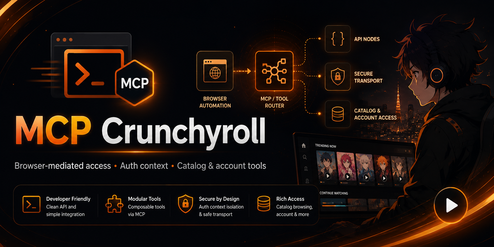

<p align="center">
  
</p>

<h1 align="center">🍥 MCP Crunchyroll</h1>

<p align="center">
  <strong>Seu agente de IA encontra animes, cuida da sua lista e dá o play,<br/>sem nunca receber a sua senha.</strong>
</p>

<p align="center">
  <a href="../README.md">Read in English</a>
</p>

---

Servidor não oficial de [Model Context Protocol](https://modelcontextprotocol.io/) (MCP) para a Crunchyroll, escrito em TypeScript. Seu cliente MCP (Claude, Hermes ou outro) ganha um conjunto fechado de ferramentas para o catálogo, a sua conta e o player. Você entra na conta numa janela de navegador dedicada, uma vez, e o servidor mantém essa sessão ativa.

<p align="center">
  
</p>

## ✨ O que dá para fazer

| | |
|---|---|
| 🔎 **Descobrir** | Pesquisar, navegar por gênero ou temporada de simulcast, ver séries, temporadas e episódios (com todas as versões de áudio) e receber recomendações. |
| 📚 **Sua conta** | Ver lista, histórico e progresso; adicionar ou remover títulos, **favoritar** e atualizar o progresso. |
| ▶️ **Assistir** | Abrir um episódio, **dar play, pausar e pôr em tela cheia**. O servidor confirma que o vídeo está mesmo tocando, não só que a página abriu. |
| 🔒 **Seguro** | O login acontece só no navegador gerenciado. Senha, cookies e tokens nunca passam pelas ferramentas. |

## 💬 Exemplos de pedidos

- “Procure Frieren e toque o episódio 1 dublado em português, em tela cheia.”
- “O que eu assisti por último? Continue de onde parei.”
- “Mostre minha lista e recomende algo parecido.”
- “Favorite esta série.”

## 🚀 Começo rápido

1. Instale o Node.js 18 ou mais recente e um navegador da família Chromium (Chrome, Chromium, Brave ou Edge).
2. Compile o servidor:

   ```bash
   git clone https://github.com/Itthiago034/mcp-crunchyroll.git
   cd mcp-crunchyroll
   npm ci && npm run build
   ```

3. Adicione ao seu cliente MCP:

   ```json
   {
     "mcpServers": {
       "crunchyroll": {
         "command": "node",
         "args": ["/caminho/absoluto/para/mcp-crunchyroll/dist/index.js"]
       }
     }
   }
   ```

4. Peça ao agente para entrar na conta. Ele chama `crunchyroll_login`, uma janela abre na página da própria Crunchyroll e você entra **uma vez**.
5. Pronto. Peça qualquer coisa da lista acima.

Para o Hermes, há também um `manifest.yaml` no repositório.

## 🔥 Entra uma vez, continua conectado

<p align="center">
  
</p>

O token da versão web da Crunchyroll dura poucos minutos e não vem com refresh token. Em vez de fazer uma chamada esperar a renovação (ou pedir login de novo), um **mantenedor de sessão** renova o token em segundo plano assim que ele expira, numa aba escondida, nunca na aba em que você está assistindo.

- **Você entra uma vez.** O perfil dedicado do navegador guarda o login da Crunchyroll, então mesmo depois de reiniciar o servidor a sessão volta sozinha.
- **As chamadas continuam rápidas.** Enquanto as ferramentas estão em uso, o token está sempre válido. Depois de uma hora sem uso o mantenedor descansa, e a próxima chamada o acorda.
- **O agente sempre sabe o que fazer.** `crunchyroll_status` devolve um `next_action` fechado: `NONE`, `CALL_CRUNCHYROLL_LOGIN`, `WAIT_FOR_LOGOUT` ou `RETRY_LATER`.
- **Nunca entra na conta por você.** Se a Crunchyroll encerrar a sessão (logout, troca de senha, revogação), o mantenedor para e pede `crunchyroll_login`, sem ficar tentando em loop.

| Variável | Padrão | Efeito |
|---|---|---|
| `CRUNCHYROLL_KEEP_WARM_MINUTES` | `60` | Quanto tempo o mantenedor fica ativo depois da última chamada. `0` desliga |
| `CRUNCHYROLL_WARM_START` | desligado | `1` restabelece a sessão salva assim que o servidor inicia (abre o navegador na inicialização) |

**Dica de login:** se a sua conta usa “Entrar com Google” ou “Entrar com Apple”, esses botões funcionam normalmente na janela gerenciada.

## Limitações

- `crunchyroll_continue_watching` e `crunchyroll_get_subscription` ainda estão desativadas.
- As interfaces web internas da Crunchyroll não são uma API pública estável e podem mudar.
- O servidor controla apenas o player oficial na web: não baixa mídia e não contorna DRM, nem as políticas de autoplay e tela cheia do navegador.
- `crunchyroll_set_favorite` segue o formato de requisição do cliente web, mas ainda não foi confirmado contra a API real.

Projeto da comunidade, sem afiliação ou endosso da Crunchyroll. Baseado no projeto de código aberto `@striderlabs/mcp-crunchyroll`; licença MIT.
