# Revisão de arquitetura, segurança e rede

Revisão de 2026-10-08. As correções mantêm o contrato das 21 ferramentas MCP
e o transporte de produção via stdio. Nenhuma chamada autenticada ao Crunchyroll
ou alteração em conta foi realizada.

## Arquitetura e mudanças

```mermaid
flowchart LR
  Client[Cliente MCP] -->|stdio| Root[Composição e redação de resultados]
  Root --> Gateway[Gateway de domínio]
  Gateway --> Registry[Registro fechado de operações]
  Registry --> Backend[Backend e identidade autenticada]
  Backend --> Session[Gerenciador de sessão]
  Session -->|CDP local limitado| Browser[Navegador com sandbox]
  Browser -->|HTTPS e leitura limitada| Provider[Crunchyroll]
```



O registro permanece responsável pelos métodos, caminhos, argumentos e corpos;
a autoridade de autenticação permanece responsável pela identidade e geração.
As mudanças concentram os limites de recursos e a liberação de assinaturas no
transporte, evitando duplicar esses controles nos handlers de ferramentas.

| Achado | Evidência | Correção |
| --- | --- | --- |
| Leitura integral antes do limite | A fixture de 100 blocos de 8 bytes consumia os 100 blocos, mesmo com orçamento de 16 bytes. | Leitura incremental: 3 blocos, cancelamento ao ultrapassar o orçamento, sem consumir os 97 restantes. |
| Limite em caracteres em vez de bytes | `😀😀` era aceito sob limite de 4, apesar de ocupar 8 bytes UTF-8. | Contagem dos bytes recebidos e decodificação incremental, inclusive com caracteres divididos entre blocos. |
| Assinaturas retidas entre chamadas | Os canais registravam callbacks sem mecanismo de remoção. | `CdpConnection.on` retorna um disposer; os testes verificam zero assinaturas retidas após 100 ciclos, além de falhas de inicialização. |
| Recursos CDP sem limites explícitos | Handshake sem deadline, fila de pendências sem teto e limite padrão de frames WebSocket. | Handshake limitado pelo timeout CDP; até 128 comandos pendentes e frames de até 4 MiB; compressão desativada. |
| Frames JSON malformados | `null` era acessado como objeto no parser. | Primitivos e arrays são ignorados; um teste intercala esses frames com uma resposta válida. |
| Encerramento dependente do peer | `close()` aguardava o fechamento remoto para rejeitar comandos. | Encerramento local imediato, cancelamento de timers, limpeza de callbacks e término do socket. |
| Origem validada sem porta | A comparação de hostname aceitava a porta 8443. | Comparação de `URL.origin`; portas alternativas e credenciais em URL são recusadas antes do dispatch. A porta padrão 443 continua válida. |
| Resultado nulo após dispatch | Teste reproduziu `TypeError` ao receber resultado CDP `null`. | Falha estrutural com `POSSIBLY_DISPATCHED`/`malformed`, preservando a classificação de mutações incertas e a ausência de retry automático. |

O limite CDP de 4 MiB acomoda o corpo de API de 512 KiB mesmo quando a
serialização JSON amplia caracteres escapados. O teto de 128 pendências é uma
política de proteção, não uma capacidade ótima demonstrada por benchmark.
Excesso de concorrência é recusado localmente antes de enviar o comando extra;
uma pendência concluída ou expirada libera capacidade.

## Dependências

O `npm audit --omit=dev` inicial reportou 14 entradas afetadas: 4 moderadas,
8 altas e 2 críticas, incluindo efeitos transitivos. Isso não significa que
14 vulnerabilidades fossem exploráveis pelo servidor stdio: vários alertas
envolviam superfícies HTTP/OAuth que este fluxo não expõe.

As dependências foram atualizadas dentro das faixas existentes no lockfile,
incluindo SDK MCP 1.27.1 → 1.32.1 e `ws` 8.21.3 → 8.22.0.
O esbuild passou de `^0.20.0` para `^0.28.2` para resolver também o alerta
de desenvolvimento GHSA-67mh-4wv8-2f99; o projeto usa build, sem expor o servidor
de desenvolvimento do esbuild. O requisito Node.js >=18 foi preservado.

Após instalação limpa, `npm audit` completo retornou zero alertas conhecidos.
Esse resultado é um retrato do registro consultado, não uma garantia de ausência
de vulnerabilidades.

## Validação reproduzível

```bash
cd /workspace/mcp-crunchyroll
npm ci --cache /workspace/.npm-cache --no-audit --no-fund
npm run typecheck
npm run build
(umask 022; CI=true CRUNCHYROLL_BROWSER_EXECUTABLE=/usr/bin/chromium npm test)
npm audit --cache /workspace/.npm-cache
git diff --check
```

Na nuvem, os testes de navegador precisam executar fora do isolamento adicional
dos comandos quando ele impede namespaces ou remapeia o proprietário do helper
SUID. O sandbox nativo do Chromium permanece habilitado. A `umask 022` permite
que o teste de armazenamento crie deliberadamente diretórios inseguros 0755.

Validação: Node.js 24.19.0, Chromium 151.0.7922.173; instalação limpa, tipos,
build e suíte de 1.017 testes passaram, sem falhas ou testes ignorados. A suíte
inclui execução da função de leitura limitada no Chromium real, fixtures
WebSocket adversariais, geração de identidade, mutações e MCP stdio no código
fonte e no bundle. A matriz Node.js 18/20/22 não foi executada localmente;
permanece no CI.

## Limites e próximas medições

- Não há medidas de latência, throughput, RSS ou percentis do Crunchyroll real.
  A redução de blocos consumidos demonstra trabalho evitado na fixture,
  sem extrapolar ganho percentual para produção.
- O deadline limita a espera local; o cancelamento de uma requisição ainda
  ativa no navegador após esse deadline precisa de um experimento específico.
  Uma futura mudança com `AbortController` deve preservar mutações incertas.
- O guard de egress do Node envolve `globalThis.fetch`, não todos os sockets,
  nem a política de saída de rede do sistema operacional. Não deve ser tratado
  como firewall geral contra código arbitrário.
- A sessão, o CDP e a leitura local foram testados. DNS, proxy, TLS, redirects,
  rate limits e login do provedor real não foram validados. Um próximo ensaio
  autorizado pode medir somente leituras, com concorrência limitada e sem
  retries de mutações, registrando tempos e categorias de erro sem credenciais.
- Cache, pooling de sessões e uma divisão ampla dos módulos de autenticação
  não foram introduzidos: faltam medidas que justifiquem os riscos de estado
  compartilhado, respostas obsoletas e invalidação. O primeiro passo é medir
  tempo de abertura de canal, tempo até headers e duração de leitura por operação.
