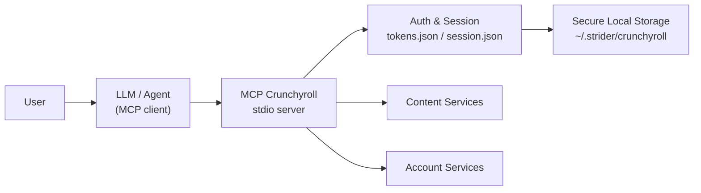

# Architecture

## Overview



MCP Crunchyroll is a **stdio MCP server** written in TypeScript (MCP SDK v1, protocol 2025-03-26). It runs as a child process of an MCP client and communicates exclusively through the standard JSON-RPC transport — there is no HTTP server in this project.

## Layers

| Layer | Responsibility |
|-------|----------------|
| **MCP boundary** (`src/index.ts`) | Tool registration, request dispatch, result formatting, secret redaction |
| **Typed operations** (`src/api.ts`) | Domain-level operations with typed results (login, logout, status, refresh orchestration) |
| **Auth & storage** (`src/auth.ts`) | Credential persistence, schema validation, secure filesystem handling |
| **Redaction** (`src/redact.ts`) | Operation-scoped secret registry and result sanitization |
| **Bundle** (`build.js` + `dist/index.js`) | Single-file esbuild bundle for deployment |

## The MCP Boundary

Every tool call crosses one explicit security boundary:

```text
LLM Agent
   ↓  tool calls
MCP Boundary  ← secret redaction (operation-scoped registry)
   ↓
Typed Operations (refresh state machine; structured logout — candidate, not in main)
   ↓
Auth / Catalog / Account
   ↓
Secure Local Storage (0700 dirs, symlink & owner validation, schema checks)
```

- Tool arguments known to be sensitive (`password`, `access_token`, `refresh_token`) are redacted from results with a closed allow-list — other arguments (query strings, titles, IDs) are deliberately kept.
- Errors and results are classified into structured states; raw network diagnostics, raw errors, and local paths never reach the client.

## Credential Lifecycle

1. `crunchyroll_login` exchanges credentials once; tokens are written to `~/.strider/crunchyroll/` (separate artifacts for tokens and session).
2. Saved tokens are **persisted-schema validated** against a frozen structural schema before being trusted.
3. On each operation, token freshness is verified; expiring tokens are refreshed through a **classified state machine** (transient failures preserve credentials; proven rejections require reauthentication).
4. `crunchyroll_logout` removes local artifacts. Per-artifact, structured logout reporting (`CLEARED` / `ALREADY_ABSENT` / `PARTIAL` / `FAILED`) is a Gate B5 candidate and is **not yet present in `main`**.

## Secure Local Storage

- Config directories created with mode `0700`; files validated on read/write with `lstat` without following symlinks.
- Symlinks, insecure modes (group/other bits set), divergent owners, and non-regular files are rejected before any credential operation.
- Directory opens are attempted with `O_NOFOLLOW` where available, with a documented fallback path.

## Not Implemented (planned)

- Browser/player orchestration (direct episode navigation, playback, pause/resume, seek) — demonstrated feasible, not implemented.
- Out-of-band / secret-handled authentication (no password crossing the LLM/MCP boundary) — designed, not implemented.
